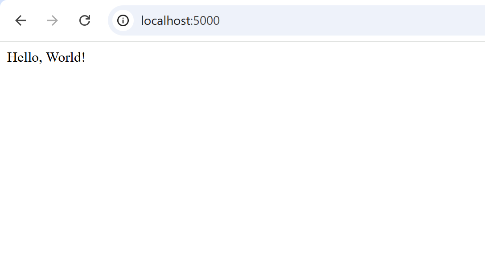
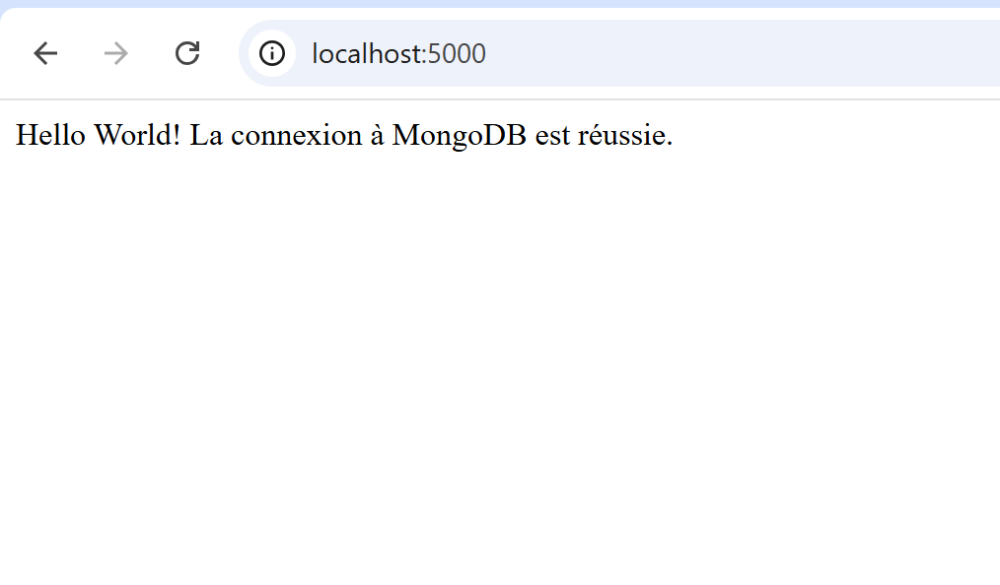

# TP Docker — Intégration et Déploiement Continus

Ce dépôt contient la réalisation du TP Docker dans le cadre du module **Intégration et déploiement continus** (Master 2 MIAGE IPM — Université Toulouse Capitole).

## Sommaire

* [1. Manipulation de base des conteneurs](#1-manipulation-de-base-des-conteneurs)
* [2. Création d'un serveur web avec Docker (Nginx)](#2-création-dun-serveur-web-avec-docker-nginx)
* [3. Déploiement d'une application Python Flask](#3-déploiement-dune-application-python-flask)
* [4. Utilisation de Docker Compose (Flask + MongoDB)](#4-utilisation-de-docker-compose-flask--mongodb)

---

## 1. Manipulation de base des conteneurs

### 1.1 Vérifier la version de Docker

**Commande :**
```bash
docker --version
```

**Résultat :**
```text
Docker version 29.9.2, build a82e528
```

### 1.2 Lister les images disponibles localement

**Commande :**
```bash
docker images
```

**Résultat :**
```text
IMAGE   ID             DISK USAGE   CONTENT SIZE   EXTRA
```

### 1.3 Télécharger une image depuis Docker Hub

**Commande :**
```bash
docker pull hello-world
```

**Résultat :**
```text
Using default tag: latest
latest: Pulling from library/hello-world
4f55086f7dd0: Pull complete 
Digest: sha256:c567b231f65614688711a75f31518a064258a51d442117a3e771a3a8fdba78ef
Status: Downloaded newer image for hello-world:latest
docker.io/library/hello-world:latest
```

### 1.4 Exécuter un conteneur à partir de l'image

**Commande :**
```bash
docker run hello-world
```

**Résultat :**
```text
Hello from Docker!
This message shows that your installation appears to be working correctly.

To generate this message, Docker took the following steps:
 1. The Docker client contacted the Docker daemon.
 2. The Docker daemon pulled the "hello-world" image from the Docker Hub.
    (amd64)
 3. The Docker daemon created a new container from that image which runs the
    executable that produces the output you are currently reading.
 4. The Docker daemon streamed that output to the Docker client, which sent it
    to your terminal.

To try something more ambitious, you can run an Ubuntu container with:
 $ docker run -it ubuntu bash

Share images, automate workflows, and more with a free Docker ID:
 https://hub.docker.com/

For more examples and ideas, visit:
 https://docs.docker.com/get-started/
```

### 1.5 Lister les conteneurs en cours d'exécution

**Commande :**
```bash
docker ps
```

**Résultat :**
```text
CONTAINER ID   IMAGE     COMMAND   CREATED   STATUS    PORTS     NAMES
```

### 1.6 Lister tous les conteneurs (actifs et arrêtés)

**Commande :**
```bash
docker ps -a
```

**Résultat :**
```text
CONTAINER ID   IMAGE         COMMAND    CREATED         STATUS                     PORTS     NAMES
a6215f313d42   hello-world   "/hello"   4 minutes ago   Exited (0) 4 minutes ago             tender_franklin
```

### 1.7 Supprimer un conteneur

**Commande :**
```bash
docker rm a6215f313d42
```

**Résultat :**
```text
a6215f313d42
```

**Vérification :**
```bash
docker ps -a
```

```text
CONTAINER ID   IMAGE     COMMAND   CREATED   STATUS    PORTS     NAMES
```

### 1.8 Supprimer une image

**Commande :**
```bash
docker rmi e2ac70e7319a
```

**Résultat :**
```text
Untagged: hello-world:latest
Untagged: hello-world@sha256:c567b231f65614688711a75f31518a064258a51d442117a3e771a3a8fdba78ef
Deleted: sha256:e2ac70e7319a02c5a477f5825259bd118b94e8b02c279c67afa63adab6d8685b
Deleted: sha256:897b3f2a7c1bc2f3d02432f7892fe31c6272c521ad4d70257df624504a3238b4
```

**Vérification :**
```bash
docker images
```

```text
IMAGE   ID             DISK USAGE   CONTENT SIZE   EXTRA
```

---

## 2. Création d'un serveur web avec Docker (Nginx)

### 2.1 Télécharger l'image officielle Nginx

**Commande :**
```bash
docker pull nginx
```

**Résultat :**
```text
Using default tag: latest
latest: Pulling from library/nginx
37fb86c2a767: Pull complete 
512ac5e7ce8e: Pull complete 
1724c05f72c6: Pull complete 
bbb080c71d50: Pull complete 
1962e1ff75b4: Pull complete 
7cb4701ce7cd: Pull complete 
6d2e43921e9e: Pull complete 
Digest: sha256:165ddde8751e75a1c907d24ef10d9f6deb08b57e0fe56caf67512486aff76d82
Status: Downloaded newer image for nginx:latest
docker.io/library/nginx:latest
```

### 2.2 Lancer un conteneur Nginx en arrière-plan

**Commande :**
```bash
docker run -d -p 8080:80 --name mon_nginx nginx
```

**Résultat :**
```text
2447d70842980df401d6d3348dc01c25088c621887c8c31dd05ec0338ee1186a
```

### 2.3 Vérifier que le conteneur est actif

**Commande :**
```bash
docker ps
```

**Résultat :**
```text
CONTAINER ID   IMAGE                                                    COMMAND                  CREATED         STATUS                    PORTS                                      NAMES
2447d7084298   nginx                                                    "/docker-entrypoint.…"   2 minutes ago   Up 2 minutes              0.0.0.0:8080->80/tcp, [::]:8080->80/tcp     mon_nginx
```

### 2.4 Accéder à la page dans le navigateur

En ouvrant l'URL `http://localhost:8080/`, la page d'accueil par défaut de Nginx s'affiche :

> **Résultat :** La page `http://localhost:8080/` est accessible et affiche *"Welcome to nginx!"*.

### 2.5 Arrêter et supprimer le conteneur

**Arrêt du conteneur :**
```bash
docker stop mon_nginx
```

```text
mon_nginx
```

**Suppression du conteneur :**
```bash
docker rm mon_nginx
```

```text
mon_nginx
```

---

## 3. Déploiement d'une application Python Flask

### 3.1 Construction de l'image Docker

**Commande :**
```bash
docker build -t hello-world .
```

**Résultat :**
```text
[+] Building 6.8s (10/10) FINISHED                                              docker:desktop-linux
 => [internal] load build definition from Dockerfile                                            0.0s
 => => transferring dockerfile: 225B                                                            0.0s
 => [internal] load metadata for docker.io/library/python:3.11-slim                             1.2s
 => [internal] load .dockerignore                                                               0.0s
 => => transferring context: 2B                                                                 0.0s
 => [internal] load build context                                                               0.0s
 => => transferring context: 78B                                                                0.0s
 => [1/5] FROM docker.io/library/python:3.11-slim@sha256:07d4824036af339fa1b6ef769cc99d9c10a141769538b52b3b597c84f7a7b535      0.0s
 => CACHED [2/5] WORKDIR /app                                                                   0.0s
 => [3/5] COPY requirements.txt .                                                               0.0s
 => [4/5] RUN pip install --no-cache-dir -r requirements.txt                                    5.0s
 => [5/5] COPY app.py .                                                                         0.1s
 => exporting to image                                                                          0.3s
 => => exporting layers                                                                         0.2s
 => => writing image sha256:0ff7ffb2340f13b643bc629da45b18f851f3e3313d04f444fb2b84916f4d3b3f   0.0s
 => => naming to docker.io/library/hello-world                                                  0.0s
```

### 3.2 Lancement du conteneur Flask

**Commande :**
```bash
docker run -d -p 5000:5000 hello-world
```

### 3.3 Test de l'application dans le navigateur

Accès à l'application sur `http://localhost:5000` :



---

## 4. Utilisation de Docker Compose (Flask + MongoDB)

### 4.1 Lancement de l'environnement multi-conteneurs

**Commande :**
```bash
docker compose up -d --build
```

**Résultat :**
```text
[+] Building 1.7s (12/12) FINISHED                                                                   
 => [internal] load local bake definitions                                                      0.0s
 => => reading from stdin 631B                                                                  0.0s
 => [internal] load build definition from Dockerfile                                            0.0s
 => => transferring dockerfile: 225B                                                            0.0s
 => [internal] load metadata for docker.io/library/python:3.11-slim                             0.8s
 => [internal] load .dockerignore                                                               0.0s
 => => transferring context: 2B                                                                 0.0s
 => [1/5] FROM docker.io/library/python:3.11-slim@sha256:07d4824036af339fa1b6ef769cc99d9c10a141769538b52b3b597c84f7a7b535      0.0s
 => [internal] load build context                                                               0.0s
 => => transferring context: 63B                                                                0.0s
 => CACHED [2/5] WORKDIR /app                                                                   0.0s
 => CACHED [3/5] COPY requirements.txt .                                                        0.0s
 => CACHED [4/5] RUN pip install --no-cache-dir -r requirements.txt                             0.0s
 => CACHED [5/5] COPY app.py .                                                                  0.0s
 => exporting to image                                                                          0.0s
 => => exporting layers                                                                         0.0s
 => => writing image sha256:af47c1b20ce39d6ad1dd3dca503b87c4084797d5b2e7420e3da458dbfd5a564e   0.0s
 => => naming to docker.io/library/tp-docker-web                                                0.0s
 => resolving provenance for metadata file                                                      0.0s
[+] up 4/4
 ✔ Image tp-docker-web         Built                                                            2.1s
 ✔ Network tp-docker_default   Created                                                          0.0s
 ✔ Container tp-docker-mongo-1 Started                                                          0.5s
 ✔ Container tp-docker-web-1   Started                                                          0.2s
```

### 4.2 Vérification de la connexion à la base de données

Accès à l'application sur `http://localhost:5000` confirmant la bonne communication entre le conteneur applicatif Flask et le conteneur MongoDB :

